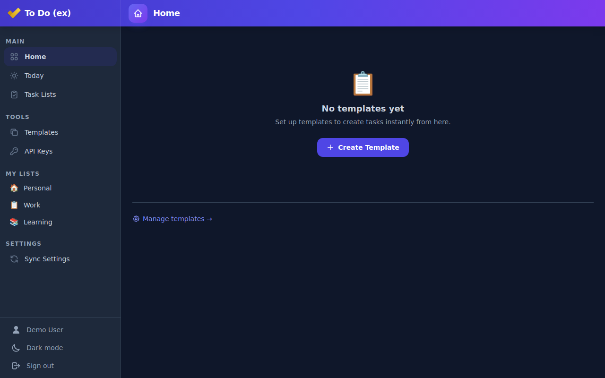

# ✅ TodoExtended

**Supercharge your productivity with Microsoft To Do**

## Key Features

### 📅 Today View
Focus on what matters today. See all tasks due today across all your lists in one place.

### 📋 Task Templates
Create recurring tasks instantly. Set up templates and create tasks with one click.

### ⚡ Quick Create
Lightning-fast task creation from your templates right from the home screen.

### ⌚ Garmin Watch Companion
Check your tasks and complete them right from your Garmin smartwatch.

### AI Task Chat
Discuss your tasks with a streaming assistant. Find tasks, plan your day, and
review proposed task or template changes before approving them. Stop a response,
retry a failed request, or start a new conversation. History is saved on this
device; restored proposals cannot be executed again.
Stopping a request does not undo task changes that have already completed.

## Development

Install the .NET 11 RC1 SDK pinned in `global.json`. The task chat uses the
experimental `Microsoft.AspNetCore.Components.AI` components (`UIAgent`,
`AgentBoundary`, `MessageList`, and custom action renderers). The existing
speech-enabled input submits messages through `AgentContext`, retaining voice
dictation and keyboard behavior.
The existing GitHub Models/Azure OpenAI configuration and demo mode still apply.

The Interactive Server page uses the scoped `IChatClient` adapter in process,
keeping task access and approvals in the authenticated Blazor circuit. The same
adapter exposes an authenticated, proposal-only AG-UI SSE endpoint at
`POST /api/chat` through `AGUI.Server`. Remote clients can stream answers and
render `review_task_action` calls, but this endpoint never executes task changes.
Only explicit review in the app invokes the trusted, server-held proposal.

Architecture references: [AG-UI .NET SDK](https://devblogs.microsoft.com/dotnet/ag-ui-dotnet-sdk/)
and [Agentic UI with Blazor](https://devblogs.microsoft.com/dotnet/build-agentic-ui-blazor/).

## Take a look

See more [screenshots](https://github.com/maraf/TodoExtended/tree/main/docs/screenshots)

---

Powered by Microsoft To Do. Sign in with your Microsoft account to get started.
